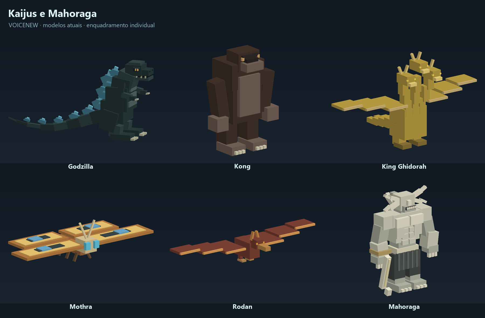
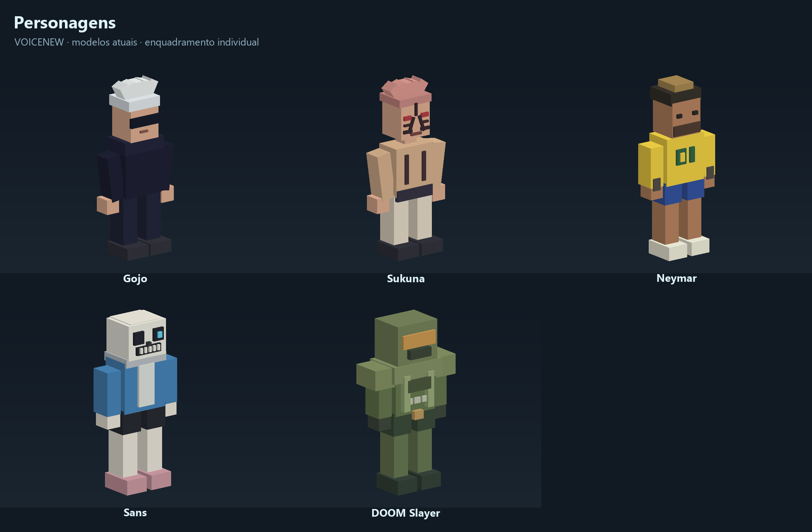
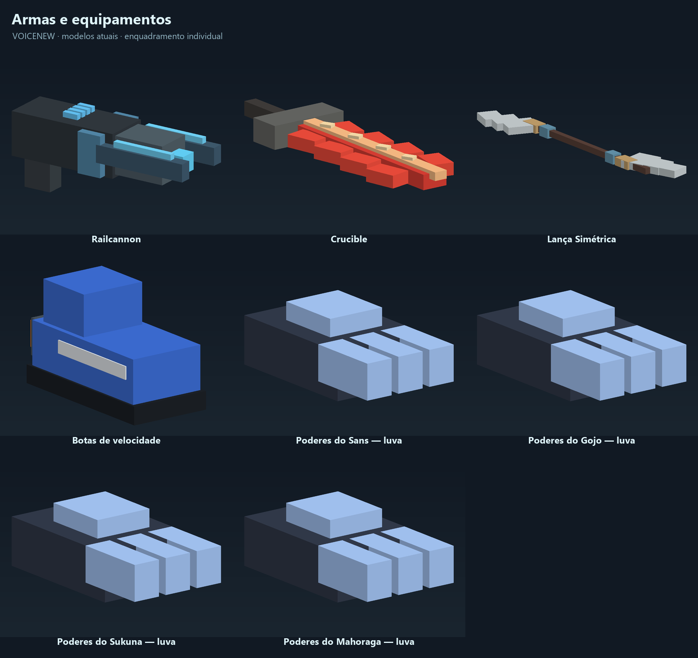
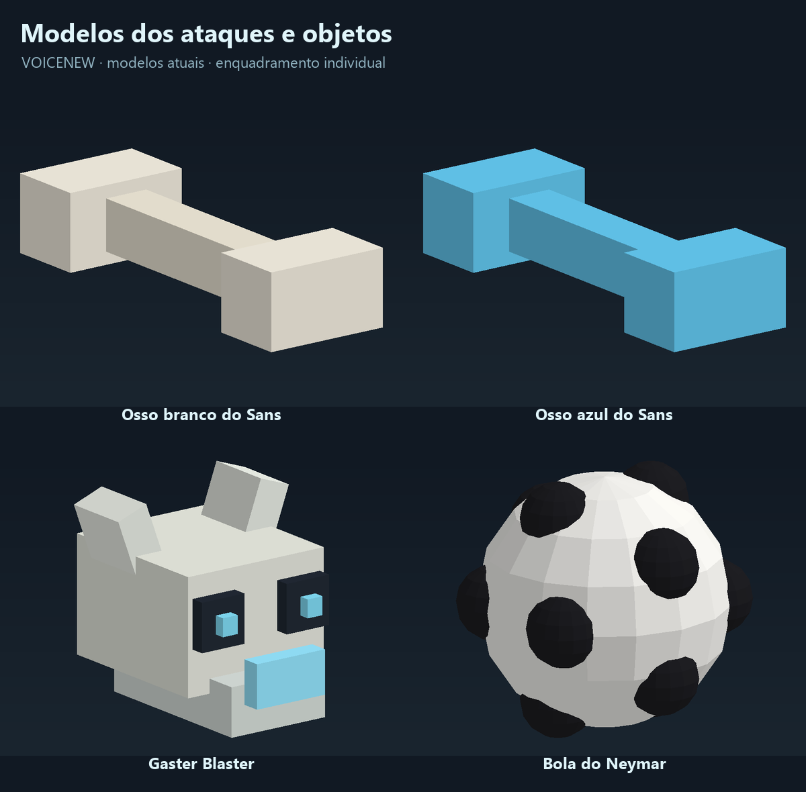

# Modelos atuais — VOICENEW v0.4.8

23 modelos dos pedidos recentes, reunidos em quatro painéis. Prévias estáticas da geometria real dos arquivos, com luz simplificada e pose de repouso; cada item tem enquadramento próprio, sem escala comum. As luvas são equipamentos de poderes. As imagens não mostram os efeitos em ação.

Modelos originais em blocos criados/adaptados para o VOICENEW. LAVOICE por **Tsomyst — Somyst Game Studio**: https://tsomyst.itch.io/lavoice.
